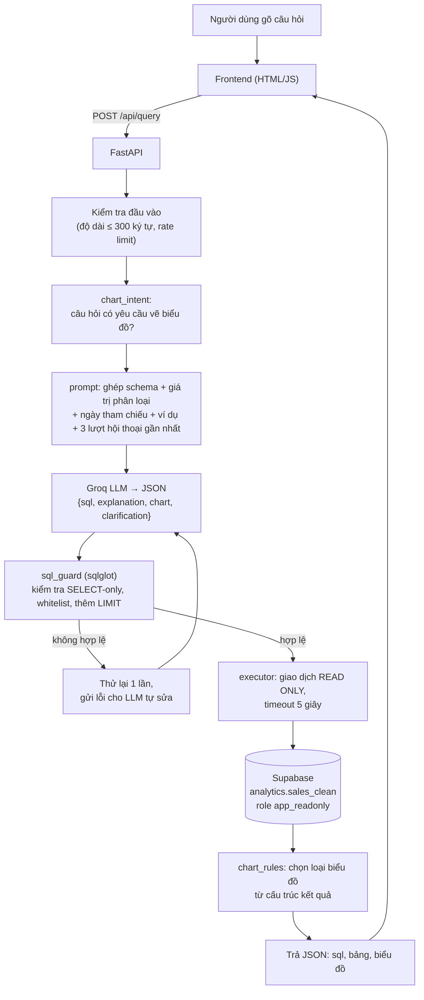

# Text2SQL BĐS – Hỏi đáp dữ liệu bất động sản bằng tiếng Việt

Đồ án tốt nghiệp: một web app cho phép **gõ câu hỏi bằng tiếng Việt**, AI tự **chuyển thành câu lệnh SQL**, chạy trên cơ sở dữ liệu và hiển thị **bảng kết quả, câu SQL, lời giải thích** và **biểu đồ (chỉ khi người dùng yêu cầu)**.

> Ví dụ: *"Số lead theo từng nguồn, vẽ biểu đồ cột"* → AI viết `SELECT nguon_lead, COUNT(*) ... GROUP BY ...` → chạy chỉ-đọc trên Supabase → hiện biểu đồ cột.

- Dữ liệu: 1.793 lead/giao dịch bất động sản (xem [Dữ liệu](#6-dữ-liệu-và-chuẩn-hóa)).
- Ngôn ngữ: Python (backend), HTML/CSS/JavaScript thuần (frontend).
- Cơ sở dữ liệu: Supabase (PostgreSQL 17). AI: Groq API (gói miễn phí).
- Thiết kế FE/BE tách bạch: frontend chỉ gọi `/api/*`, không chạm DB.

---

## Mục lục

1. [Công cụ và công nghệ sử dụng](#1-công-cụ-và-công-nghệ-sử-dụng)
2. [Luồng hoạt động](#2-luồng-hoạt-động)
3. [Lý thuyết nền tảng](#3-lý-thuyết-nền-tảng)
4. [Cấu trúc thư mục](#4-cấu-trúc-thư-mục)
5. [API](#5-api)
6. [Dữ liệu và chuẩn hóa](#6-dữ-liệu-và-chuẩn-hóa)
7. [Bảo mật](#7-bảo-mật)
8. [Chạy local](#8-chạy-local)
9. [Kiểm thử và đánh giá](#9-kiểm-thử-và-đánh-giá)
10. [Deploy lên Render](#10-deploy-lên-render)
11. [Hạn chế và hướng phát triển](#11-hạn-chế-và-hướng-phát-triển)
12. [Tài liệu trong repo](#12-tài-liệu-trong-repo)

---

## 1. Công cụ và công nghệ sử dụng

| Nhóm | Công cụ | Vai trò trong dự án |
|---|---|---|
| **AI / LLM** | **Groq API** (model `openai/gpt-oss-120b`, dự phòng `openai/gpt-oss-20b`) | Hiểu câu hỏi tiếng Việt và sinh SQL ở dạng JSON |
| | Thư viện `groq` 1.7 | Gọi API, bắt lỗi giới hạn tốc độ (429) |
| **Backend** | **FastAPI** 0.162 + **Uvicorn** | Web API bất đồng bộ, phục vụ luôn cả file frontend |
| | **Pydantic** 2 / pydantic-settings | Kiểm tra dữ liệu vào/ra, đọc cấu hình từ biến môi trường |
| | **sqlglot** 30 | Phân tích SQL thành cây cú pháp (AST) để kiểm tra an toàn |
| | **psycopg 3** + psycopg-pool | Kết nối PostgreSQL bất đồng bộ qua connection pool |
| | **slowapi** | Giới hạn số câu hỏi theo IP (rate limit) |
| **Cơ sở dữ liệu** | **Supabase** (PostgreSQL 17) | Lưu dữ liệu; **Session Pooler** để kết nối từ máy chủ không có IPv6 |
| **Frontend** | HTML + CSS + JavaScript module (không framework) | Giao diện hỏi đáp |
| | **Chart.js** 4.4 (đã vendor) | Vẽ biểu đồ cột, cột ngang, đường, tròn, vành khuyên, phân tán |
| | Be Vietnam Pro (tự lưu trong repo) | Font hỗ trợ đầy đủ dấu tiếng Việt |
| **Chất lượng** | **pytest**, **ruff** | Test và lint backend |
| | **Playwright** | Test giao diện end-to-end (`frontend/e2e`) |
| **Triển khai** | **Docker**, **Render** | Đóng gói và chạy trên đám mây (gói free) |
| **Thiết kế** | Canvas thiết kế trên claude.ai | Bản demo UI được duyệt trước khi code |

---

## 2. Luồng hoạt động



**Từng bước:**

1. **Nhập câu hỏi.** Frontend gửi `POST /api/query` kèm tối đa 3 lượt hội thoại gần nhất (để hiểu các câu như "còn ở Hà Nội thì sao?").
2. **Kiểm tra đầu vào.** Giới hạn độ dài câu hỏi, giới hạn tốc độ theo IP (mặc định 10 câu/phút).
3. **Nhận biết yêu cầu biểu đồ** (`chart_intent`). Bằng quy tắc, không dùng AI: tìm "biểu đồ", "đồ thị", "vẽ", "dạng cột/tròn/đường"... (không phân biệt dấu, hiểu phủ định kiểu "không cần vẽ"). Nếu không được yêu cầu thì server **không bao giờ trả biểu đồ**.
4. **Dựng prompt** (`prompt.py`). Gồm vai trò và quy tắc, mô tả schema bằng tiếng Việt, toàn bộ giá trị phân loại có thật (trạng thái, nguồn lead, tỉnh...), định nghĩa nghiệp vụ, "hôm nay là 2026-11-08", và các ví dụ mẫu (few-shot) gồm cả ví dụ từ chối.
5. **Gọi LLM** (`llm.py`). `temperature=0`, bắt buộc đầu ra JSON. Nếu model chính bị giới hạn tốc độ (429) thì chuyển sang model dự phòng.
6. **Kiểm tra SQL** (`sql_guard.py`). Phân tích thành cây cú pháp và từ chối nếu không đạt (chi tiết ở [Bảo mật](#7-bảo-mật)). Tự thêm hoặc hạ `LIMIT` tối đa 500 dòng.
7. **Tự sửa lỗi.** Nếu SQL bị từ chối hoặc JSON sai định dạng, hệ thống gửi lại đúng thông báo lỗi cho LLM để sửa, **thử lại tối đa 1 lần**.
8. **Chạy truy vấn** (`executor.py`). Trong giao dịch `READ ONLY`, `statement_timeout` 5 giây, qua role DB chỉ có quyền đọc một view.
9. **Chọn biểu đồ** (`chart_rules.py`). Nếu có yêu cầu, chọn loại biểu đồ dựa trên *hình dạng* kết quả (cột thời gian → đường; một cột phân loại + một cột số → cột/cột ngang/tròn; hai cột số → phân tán...). Gợi ý của LLM chỉ được giữ nếu cột đó có thật và là số.
10. **Hiển thị.** Frontend vẽ bảng, biểu đồ (Chart.js), tab SQL, nút sao chép SQL, tải CSV, gợi ý câu hỏi tiếp theo và lưu lịch sử câu hỏi vào trình duyệt.

**Trường hợp đặc biệt:** câu hỏi ngoài phạm vi hoặc đòi thông tin cá nhân (ví dụ "cho tôi số điện thoại khách") → LLM trả `sql = null` kèm lý do → giao diện hiển thị thẻ "Không thể thực hiện yêu cầu này"; câu hỏi mơ hồ → thẻ "Cần làm rõ thêm".

---

## 3. Lý thuyết nền tảng

### 3.1. LLM (Large Language Model)

LLM là mạng nơ-ron Transformer được huấn luyện trên lượng văn bản rất lớn để **dự đoán token tiếp theo**. Nhờ đó nó có thể hiểu và sinh ngôn ngữ tự nhiên *và cả mã nguồn* (SQL, Python...). Một số khái niệm được dùng trong dự án:

- **Prompt (system / user):** *system prompt* đặt vai trò, quy tắc và ngữ cảnh; *user message* là câu hỏi của người dùng. Chất lượng đầu ra phụ thuộc nhiều vào prompt.
- **In-context learning / few-shot:** đưa vài ví dụ "câu hỏi → đáp án" vào prompt để model bắt chước định dạng và cách suy luận mà **không cần huấn luyện lại**. Dự án dùng few-shot (tách riêng khỏi bộ đánh giá để tránh rò rỉ đáp án).
- **Temperature:** độ ngẫu nhiên khi chọn token. Đặt `0` để đầu ra ổn định nhất có thể (không đảm bảo giống nhau tuyệt đối giữa các lần gọi).
- **JSON mode (`response_format=json_object`):** buộc đầu ra là JSON hợp lệ *về cú pháp*. Nó không đảm bảo đúng *cấu trúc* mong muốn, nên dự án còn kiểm tra thêm bằng **Pydantic**.
- **Hallucination (bịa đặt):** LLM có thể sinh tên cột không tồn tại hoặc hiểu sai nghiệp vụ. Dự án giảm rủi ro bằng cách: liệt kê schema và giá trị thật trong prompt, kiểm tra SQL bằng parser, chạy thử rồi cho LLM sửa khi lỗi.
- **Prompt injection:** văn bản do người dùng gửi có thể cố "ra lệnh" cho model. Vì vậy phòng thủ **không dựa vào model**: dù model bị lừa, SQL vẫn phải qua `sql_guard` và chạy bằng role chỉ đọc.
- **Groq:** nền tảng suy luận (inference) tốc độ cao cho các model mã nguồn mở, có gói miễn phí giới hạn tốc độ → dự án có model dự phòng khi gặp lỗi 429.

### 3.2. Text-to-SQL

**Text-to-SQL** là bài toán chuyển câu hỏi tự nhiên thành SQL để người không biết SQL vẫn truy vấn được dữ liệu. Lịch sử: từ luật thủ công → mô hình seq2seq (bộ dữ liệu WikiSQL, Spider) → **LLM với in-context learning** (cách dự án dùng). Các khó khăn chính:

- **Schema linking:** ánh xạ cụm từ trong câu hỏi ("nguồn khách", "doanh thu") sang đúng cột/giá trị trong DB. Dự án giải quyết bằng mô tả cột tiếng Việt và liệt kê giá trị phân loại trong prompt.
- **Mơ hồ nghiệp vụ:** "doanh thu" tính theo hợp đồng đã ký hay cả đặt cọc? → phải **định nghĩa trong prompt** (xem [mục 6](#định-nghĩa-nghiệp-vụ)).
- **Thời gian tương đối:** "30 ngày qua" cần biết "hôm nay" → prompt cung cấp ngày tham chiếu `2026-11-08` và yêu cầu dùng ngày cố định, không dùng `NOW()`.
- **Một bảng phẳng thay vì nhiều bảng:** dữ liệu được gom vào một view để LLM **không phải viết JOIN**, giảm đáng kể lỗi sinh SQL.
- **Đánh giá:** dùng **execution accuracy** (so *kết quả* khi chạy SQL của model với SQL chuẩn) thay vì so chuỗi SQL, vì nhiều câu SQL khác nhau có thể cho cùng kết quả.

### 3.3. Phân tích SQL bằng cây cú pháp (AST) và `sqlglot`

Thay vì lọc bằng regex (dễ bị lách bằng chú thích, viết hoa/thường, unicode), dự án **parse SQL thành cây cú pháp** bằng `sqlglot` rồi duyệt cây: đúng một câu lệnh, gốc là `SELECT/WITH`, không chứa nút ghi dữ liệu (`INSERT/UPDATE/DELETE/DDL`), chỉ gọi bảng và hàm nằm trong danh sách cho phép.

### 3.4. Phòng thủ nhiều lớp và nguyên tắc đặc quyền tối thiểu

Không tin một lớp bảo vệ duy nhất. Dù AI sinh SQL nguy hiểm: (1) `sql_guard` chặn → (2) giao dịch `READ ONLY` chặn ghi → (3) role `app_readonly` chỉ có `SELECT` trên đúng một view và không đọc được bảng gốc → (4) `statement_timeout` cắt truy vấn chạy lâu. Đây là *least privilege* và *defense in depth*.

### 3.5. Cơ sở dữ liệu quan hệ và PostgreSQL

- **View:** bảng ảo định nghĩa bằng câu `SELECT`; ở đây `analytics.sales_clean` ép kiểu dữ liệu, đổi tên cột và ẩn cột nhạy cảm mà **không sửa bảng gốc**.
- **Role và quyền (`GRANT/REVOKE`), Row Level Security:** kiểm soát ai được đọc gì.
- **Connection pooling (Supabase Session Pooler):** dùng chung kết nối, và cho phép kết nối qua IPv4 từ các máy chủ như Render.
- **Chuẩn hóa dữ liệu (data cleaning):** CSV nhập vào có toàn cột kiểu text; cần ép về số/ngày, thống nhất các giá trị trùng nghĩa.

### 3.6. Chọn biểu đồ theo cấu trúc dữ liệu

Loại biểu đồ nên được quyết định bởi *kiểu cột* của kết quả: thời gian → đường; một chiều phân loại + một số đo → cột hoặc cột ngang (nhãn dài hoặc nhiều nhóm) hoặc tròn (cơ cấu, ít phần); hai số đo → phân tán. Dự án dùng bộ quy tắc xác định (`chart_rules.py`) thay vì tin hoàn toàn vào LLM.

### 3.7. Rate limiting và REST API

Giới hạn số yêu cầu theo IP để tránh lạm dụng và tiết kiệm hạn mức Groq miễn phí. API theo kiểu REST/JSON, lỗi có mã máy đọc được (`{"error": {"code", "message"}}`) để frontend hiển thị đúng thẻ trạng thái.

---

## 4. Cấu trúc thư mục

```
AI-Web/
├─ backend/
│  ├─ app/
│  │  ├─ main.py, config.py, schemas.py, errors.py, schema_info.py, demo.py
│  │  ├─ api/routes.py            # /api/query, /api/schema, /api/examples, /health
│  │  ├─ services/
│  │  │  ├─ prompt.py             # dựng system prompt + few-shot
│  │  │  ├─ llm.py                # gọi Groq, parse JSON, model dự phòng
│  │  │  ├─ sql_guard.py          # kiểm tra SQL bằng sqlglot
│  │  │  ├─ executor.py           # chạy SQL chỉ-đọc, giới hạn dòng
│  │  │  ├─ chart_intent.py       # có yêu cầu vẽ biểu đồ không
│  │  │  ├─ chart_rules.py        # chọn loại biểu đồ
│  │  │  └─ query_service.py      # điều phối toàn bộ luồng + thử lại
│  │  └─ db/pool.py
│  ├─ tests/ (unit/, integration/, eval/)
│  └─ requirements.txt, requirements-dev.txt, pyproject.toml
├─ frontend/
│  ├─ index.html
│  ├─ css/ (tokens, base, layout, components, states, fonts)
│  ├─ js/  (api, main, chart, history, csv, loading, followups, states...)
│  ├─ fonts/, vendor/ (Chart.js)
│  └─ e2e/ (smoke.js, ui.js – Playwright)
├─ db/migrations/                 # 001 view chuẩn hóa, 002 role chỉ đọc, 003 loại dòng lỗi ngày, verify, rollback
├─ docs/                          # kế hoạch, báo cáo duyệt, báo cáo dev, ảnh chụp giao diện
├─ Dockerfile, render.yaml, .env.example
```

---

## 5. API

| Phương thức | Đường dẫn | Mô tả |
|---|---|---|
| `POST` | `/api/query` | Nhận `{question, history[]}`, trả `{sql, explanation, columns, rows, row_count, truncated, chart_requested, chart, clarification, elapsed_ms}` |
| `GET` | `/api/schema` | Mô tả các cột và giá trị phân loại (cho panel "cấu trúc dữ liệu") |
| `GET` | `/api/examples` | Câu hỏi mẫu cho trang chủ |
| `GET` | `/health` | Tình trạng máy chủ và DB (cũng cho biết có đang ở chế độ demo không) |

Mã lỗi: `INVALID_INPUT` (422), `SQL_REJECTED` (400), `RATE_LIMITED` (429), `DB_TIMEOUT` (504), `LLM_UNAVAILABLE` (503); câu hỏi ngoài phạm vi trả về văn bản giải thích thay vì lỗi.

---

## 6. Dữ liệu và chuẩn hóa

Bảng gốc `public.sales` (1.800 dòng) có **toàn bộ 40 cột kiểu `text`** và định dạng lẫn lộn. Dự án **không sửa bảng gốc**; thay vào đó tạo view `analytics.sales_clean`:

- **Ép kiểu:** tiền VND → `bigint`; diện tích → `numeric` (đổi dấu phẩy `69,9` thành `69.9`); phần trăm → `smallint`; ngày → `date`.
- **Ba định dạng ngày lẫn nhau** được xử lý bằng hàm riêng: `dd/mm/yyyy`, `yyyy-mm-dd hh:mm:ss` và **số serial của Excel** (ví dụ `46334`).
- **Gom trạng thái pipeline:** 16 giá trị gốc (nhiều giá trị trùng nghĩa như "Lead mới" và "Mới", "Đàm phán" và "Đang thương lượng") được gom thành 8 trạng thái chuẩn: Mới, Đang tư vấn, Hẹn xem, Đã xem, Đàm phán, Đặt cọc, Ký HĐ, Thất bại.
- **Ẩn thông tin cá nhân:** họ tên, SĐT, email khách hàng và hai cột ghi chú tự do không có trong view, nên AI không bao giờ thấy.
- **Loại 7 dòng lỗi nhập liệu** có ngày đặt cọc hoặc ký hợp đồng sau ngày chốt dữ liệu (2026-11-08) → view còn **1.793 dòng**. Bảng gốc vẫn đủ 1.800 dòng.

### Định nghĩa nghiệp vụ

- **Doanh thu** = tổng `gia_tri_giao_dich_vnd` của giao dịch ở trạng thái `Ký HĐ`. Tiền cọc là chỉ tiêu riêng.
- **Tỷ lệ chốt** = số `Ký HĐ` / tổng số lead trong nhóm (mẫu số gồm mọi trạng thái, kể cả `Thất bại`).
- **Ngày tham chiếu** `REFERENCE_DATE=2026-11-08`; "30 ngày qua" tính từ ngày này.

### Migration

| File | Nội dung |
|---|---|
| `001_clean_view.sql` | Schema `analytics`, bảng ánh xạ trạng thái, hàm parse ngày, view `sales_clean` |
| `002_readonly_role.sql` | Role `app_readonly`: chỉ `SELECT` trên view, `statement_timeout=5s`, mặc định chỉ đọc, tối đa 10 kết nối |
| `003_exclude_future_dated_rows.sql` | Loại 7 dòng có ngày sau 2026-11-08 |
| `verify.sql` | Các phép kiểm: số dòng, ép kiểu không mất dữ liệu, tổng tiền, thứ tự ngày |
| `999_rollback.sql` | Gỡ toàn bộ schema `analytics` và role (không đụng `public.sales`) |

---

## 7. Bảo mật

1. **`sql_guard`:** đúng một câu `SELECT`/`WITH`; cấm `INSERT/UPDATE/DELETE`, DDL, `SELECT INTO`, `FOR UPDATE`, comment, `WITH RECURSIVE`; chỉ cho phép bảng `sales_clean` và các hàm trong whitelist (chặn `pg_sleep`, `set_config`, `generate_series`, `pg_*`...); tự thêm/hạ `LIMIT` tối đa 500.
2. **Giao dịch `READ ONLY`** và `statement_timeout` 5 giây cho mỗi truy vấn.
3. **Role `app_readonly`:** chỉ đọc một view; không có quyền trên `public.sales`. Ứng dụng không dùng `service_role` hay mật khẩu `postgres`.
4. **Kết quả truy vấn không bao giờ gửi lại cho LLM** → dữ liệu không thể "tiêm lệnh" vào prompt.
5. **Thông tin cá nhân** không có trong view; câu hỏi đòi PII bị LLM từ chối theo prompt.
6. **Rate limit** theo IP, giới hạn kích thước body, CORS theo `ALLOWED_ORIGINS`; log che khóa API và chuỗi kết nối.
7. **Frontend:** chỉ dùng `textContent`, không dùng `innerHTML` (chống XSS), có Content-Security-Policy; lịch sử trong trình duyệt chỉ lưu câu hỏi, không lưu câu chứa số điện thoại hay `@`; xuất CSV chống "CSV injection".
8. **Bí mật** (`GROQ_API_KEY`, `DATABASE_URL`) chỉ nằm trong `.env` (đã `.gitignore`) hoặc biến môi trường của Render.

---

## 8. Chạy local

```bash
cd backend
python -m venv .venv && source .venv/bin/activate
pip install -r requirements-dev.txt
cp ../.env.example ../.env      # điền GROQ_API_KEY và DATABASE_URL
uvicorn app.main:app --reload --port 8000
# mở http://localhost:8000
```

**Biến môi trường chính** (xem `.env.example`):

| Biến | Ý nghĩa | Mặc định |
|---|---|---|
| `GROQ_API_KEY` | Khóa Groq (tạo miễn phí tại console.groq.com) | – |
| `GROQ_MODEL` / `GROQ_FALLBACK_MODEL` | Model chính / dự phòng | `openai/gpt-oss-120b` / `openai/gpt-oss-20b` |
| `DATABASE_URL` | Chuỗi **Session Pooler** của Supabase, user `app_readonly.<project-ref>` | – |
| `REFERENCE_DATE` | Ngày dùng làm "hôm nay" | `2026-11-08` |
| `MAX_ROWS`, `STATEMENT_TIMEOUT_MS` | Giới hạn dòng, thời gian truy vấn | `500`, `5000` |
| `RATE_LIMIT` | Giới hạn câu hỏi theo IP | `10/minute` |
| `ALLOWED_ORIGINS` | Danh sách origin CORS | `http://localhost:8000` |
| `DEMO_MODE` | Dùng AI và dữ liệu **giả** để thử giao diện | `false` |

> **Không bật `DEMO_MODE` ở production.** Khi bật, giao diện hiện huy hiệu "Chế độ demo" để dữ liệu giả không bị hiểu nhầm là thật.

**Đặt mật khẩu cho role chỉ đọc** (trong Supabase SQL Editor; tự chọn chuỗi mạnh, không commit):

```sql
ALTER ROLE app_readonly PASSWORD '<mật khẩu mạnh>';
```

---

## 9. Kiểm thử và đánh giá

```bash
cd backend && ruff check . && ruff format --check . && pytest   # 136 test, không cần key/DB

# Giao diện (cần Playwright, backend ở chế độ demo)
DEMO_MODE=true RATE_LIMIT=1000/minute python -m uvicorn app.main:app --app-dir backend --port 8000
node frontend/e2e/smoke.js     # 12 kiểm tra nhanh
node frontend/e2e/ui.js        # bộ đầy đủ ~190 kiểm tra (mobile 390px, XSS, trạng thái lỗi...)

# Đánh giá độ chính xác Text-to-SQL (cần GROQ_API_KEY và DATABASE_URL)
cd backend && python -m tests.eval.run_eval
```

**Đánh giá độ chính xác (execution accuracy):** bộ 20 câu hỏi tiếng Việt có SQL chuẩn + 2 câu phải bị từ chối (xóa bảng, xin số điện thoại). Lần chạy thật gần nhất với Groq `openai/gpt-oss-120b`: **20/20 câu đúng, 2/2 câu từ chối đúng** (một lần chạy, so sánh sau khi làm tròn; SQL được chạy qua công cụ Supabase thay vì kết nối trực tiếp). Chi tiết và hạn chế: `docs/05-final-run.md`.

---

## 10. Deploy lên Render

1. Repo có `Dockerfile` và `render.yaml`. Tạo **Web Service** (Docker) từ repo, hoặc dùng Blueprint.
2. Đặt secret trong Render Dashboard › Environment: `GROQ_API_KEY`, `DATABASE_URL` (chuỗi Session Pooler). Không đặt `DEMO_MODE`.
3. Gói free **ngủ khi không có truy cập**: lần mở đầu có thể chậm 30–60 giây. Nên mở trước khi demo.
4. Kiểm tra: `/health` trả `"db": "ok"`; hỏi thử vài câu mẫu.

---

## 11. Hạn chế và hướng phát triển

**Hạn chế hiện tại**
- Độ chính xác chỉ mới đánh giá trên 20 câu mẫu, một lần chạy; câu hỏi phức tạp hoặc mơ hồ có thể sai.
- Chỉ hỏi được trên **một bảng phẳng**; không hỗ trợ nhiều bảng và JOIN.
- Giới hạn tốc độ của Groq gói miễn phí; lúc bị 429 hệ thống chuyển sang model nhỏ hơn.
- Gợi ý "hỏi lại" chỉ là văn bản; chưa có nút trả lời nhanh.
- Giao diện mới được kiểm trên Chromium; chưa thử Safari/Firefox và bộ gõ tiếng Việt thật.

**Hướng phát triển:** mở rộng bộ đánh giá lên hàng trăm câu, thêm đăng nhập và phân quyền theo người dùng, bộ nhớ đệm cho câu hỏi lặp, hỗ trợ nhiều bảng (JOIN) có kiểm soát, và xuất báo cáo.

---

## 12. Tài liệu trong repo

| File | Nội dung |
|---|---|
| `docs/01-plan.md` | Phương án kiến trúc ban đầu |
| `docs/02-review-and-handoff.md` | Kết quả duyệt phương án và bàn giao dev |
| `docs/03-dev-report.md` | Báo cáo triển khai backend và dữ liệu |
| `docs/04-cto-review.md` | Review cuối backend |
| `docs/05-final-run.md` | Lần chạy thật với Groq/Supabase, xử lý dòng lỗi ngày |
| `docs/06-ui-review-and-handoff.md` | Duyệt thiết kế UI và bàn giao frontend |
| `docs/07-frontend-dev-report.md` | Báo cáo triển khai frontend |
| `docs/08-cto-review-frontend.md` | Review cuối frontend |
