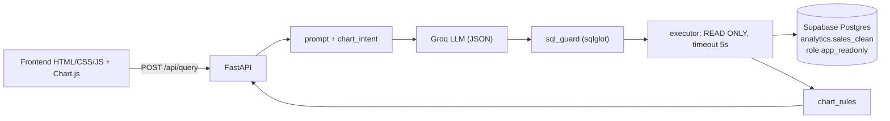

# Hỏi đáp dữ liệu bất động sản (Text-to-SQL)

Web app cho phép hỏi bằng tiếng Việt về dữ liệu bán bất động sản (1.800 lead/giao dịch). Hệ thống dùng LLM (Groq) sinh SQL PostgreSQL, kiểm tra an toàn, chạy chỉ-đọc trên Supabase và hiển thị bảng, giải thích, SQL và biểu đồ (chỉ khi người dùng yêu cầu).

## Kiến trúc



- `backend/app`: FastAPI (`api/`, `services/{prompt,llm,sql_guard,executor,chart_intent,chart_rules,query_service}.py`, `db/pool.py`).
- `frontend/`: giao diện thuần (HTML/CSS/JS module + Chart.js đã vendor, font Be Vietnam Pro tự lưu), gọi `/api/*`; được FastAPI phục vụ cùng origin. CSS: `css/{tokens,base,layout,components,states}.css`; JS: `js/*.js` (mỗi file một trách nhiệm); không dùng `innerHTML`.
- `db/migrations/`: `001_clean_view.sql`, `002_readonly_role.sql`, `verify.sql`, `999_rollback.sql`.
- `backend/tests/`: unit test (không cần key/DB), `eval/` (bộ 20 câu + 2 câu từ chối), `integration/` (cần DB thật).

## Chạy local

```bash
cd backend
python -m venv .venv && source .venv/bin/activate
pip install -r requirements-dev.txt
cp ../.env.example ../.env      # điền GROQ_API_KEY và DATABASE_URL
uvicorn app.main:app --reload --port 8000
# mở http://localhost:8000
```

Thử giao diện không cần key/DB (AI và dữ liệu giả lập, chỉ trả lời vài câu mẫu): `DEMO_MODE=true uvicorn app.main:app`. **Không bật DEMO_MODE ở production.**

Kiểm thử và lint: `ruff check . && ruff format --check . && pytest` (trong `backend/`).
Kiểm thử giao diện (cần Playwright; backend ở DEMO_MODE, nới giới hạn tốc độ để test không bị 429):

```bash
DEMO_MODE=true RATE_LIMIT=1000/minute python -m uvicorn app.main:app --app-dir backend --port 8000
node frontend/e2e/smoke.js   # smoke nhanh (chụp ảnh vào docs/screenshots)
node frontend/e2e/ui.js      # bộ đầy đủ 12 nhóm theo docs/06 (BASE_URL, SHOT_DIR, SHOTS=0 để bỏ chụp ảnh)
```

## Dữ liệu và quyền truy cập

Migration (đã áp dụng cho project Supabase `kxebriimlhwenbzfkekd`, không sửa `public.sales`):

1. `001_clean_view.sql`: schema `analytics`, bảng `pipeline_status_map` (16 trạng thái gốc thành 8 nhóm), hàm `parse_vn_date`/`parse_vn_ts` (xử lý 3 định dạng ngày: `dd/mm/yyyy`, `yyyy-mm-dd hh:mm:ss`, số serial Excel), view phẳng `analytics.sales_clean`. Cột thông tin cá nhân và 2 cột ghi chú tự do không có trong view.
2. `002_readonly_role.sql`: role `app_readonly` chỉ có `SELECT` trên `analytics.sales_clean`, `statement_timeout=5s`, `default_transaction_read_only=on`, tối đa 10 kết nối. Role **không có mật khẩu** cho tới khi bạn tự đặt.
3. `verify.sql`: các phép kiểm số dòng, kiểu dữ liệu, ngày không bị NULL do parse, tổng tiền. Gỡ bỏ: `999_rollback.sql`.

### Đặt mật khẩu cho `app_readonly`

Trong Supabase SQL Editor (tự chọn chuỗi mạnh, đừng dán vào chat hay commit):

```sql
ALTER ROLE app_readonly PASSWORD '<mật khẩu mạnh của bạn>';
```

Rồi lấy chuỗi **Session Pooler** ở Supabase Dashboard > Connect (cổng 5432, user `app_readonly.kxebriimlhwenbzfkekd`) và đặt vào `DATABASE_URL` trong `.env` (local) hoặc biến môi trường trên Render. Ứng dụng không dùng `service_role` hay mật khẩu `postgres`.

## Định nghĩa nghiệp vụ

- Doanh thu = tổng `gia_tri_giao_dich_vnd` của giao dịch `Ký HĐ`. Tiền cọc (`tien_coc_vnd`) là chỉ tiêu riêng, không phải doanh thu.
- Tỷ lệ chốt = số `Ký HĐ` / tổng số lead trong nhóm (mẫu số gồm mọi trạng thái, kể cả `Thất bại`).
- Ngày tham chiếu `REFERENCE_DATE=2026-11-08` ("30 ngày qua" tính từ ngày này). Có 2 hợp đồng và 6 đặt cọc mang ngày sau 2026-11-08 (bất thường dữ liệu), được giữ nguyên.

## Bảo mật

- `sql_guard`: đúng một câu SELECT/WITH trên `sales_clean`; cấm DML/DDL, `SELECT INTO`, `FOR UPDATE`, comment, bảng/schema khác, hàm ngoài whitelist (`pg_sleep`, `set_config`, `generate_series`... bị chặn); tự thêm/giới hạn `LIMIT` (tối đa 500 dòng).
- Giao dịch `READ ONLY` + `statement_timeout`; role DB chỉ đọc một view; kết quả truy vấn không bao giờ gửi lại cho LLM.
- Rate limit theo IP (mặc định 10/phút, trả 429), giới hạn kích thước body, CORS theo `ALLOWED_ORIGINS`, log che khóa API và chuỗi kết nối.
- Frontend dùng `textContent`, không dùng `innerHTML` với dữ liệu server.

## Deploy lên Render

1. Đẩy repo lên GitHub; trên Render tạo Web Service từ repo (Docker) hoặc dùng `render.yaml` (Blueprint).
2. Đặt secret trong dashboard: `GROQ_API_KEY`, `DATABASE_URL`. Các biến khác xem `.env.example`; đặt `ALLOWED_ORIGINS` đúng URL của dịch vụ.
3. Gói free sẽ ngủ khi không có truy cập: lần mở đầu có thể chậm 30-60 giây (cold start). Nên mở trước khi demo. Phương án dự phòng: Hugging Face Spaces (Docker), chưa cấu hình sẵn.

## Đánh giá

`cd backend && python -m tests.eval.run_eval` (cần `GROQ_API_KEY` và `DATABASE_URL`). Mục tiêu: execution accuracy >= 85% trên 20 câu và 2 câu từ chối đúng. Kết quả ghi trong `docs/03-dev-report.md`.
